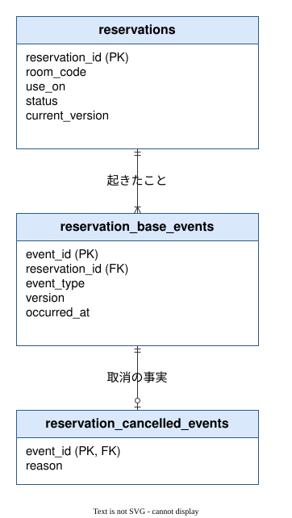

# 予約のコマンドデータモデル

## リソース系とイベント系

| 系列 | 性質 | 論理テーブル | 保存表現 | 根拠 |
|---|---|---|---|---|
| リソース系 | 業務 | `reservations` | 現在状態 | 予約の業務知識 |
| イベント系 | 業務 | `reservation_base_events` | イベント列 | 予約の業務知識 |
| イベント系 | 業務 | `reservation_cancelled_events` | イベント列 | 予約取消の業務知識 |
| イベント系 | 技術 | `cancel_notice_requested_events` | イベント列 | 取消を知らせる要求 |
| イベント系 | 技術 | `cancel_notice_claimed_events` | イベント列 | 取消を知らせる要求 |
| イベント系 | 技術 | `cancel_notice_succeeded_events` | イベント列 | 取消を知らせる要求 |

## 予約と出来事の関係

| 関係元 | 関係先 | 多重度 | 意味 |
|---|---|---|---|
| `reservations` | `reservation_base_events` | 1対1以上 | 起きたこと |
| `reservation_base_events` | `reservation_cancelled_events` | 1対0か1 | 取消の事実 |

## テーブル定義

### `reservations`（予約）

予約を見分ける識別子と、予約したときに決まる会議室と利用日。

| 列 | 型 | キー | 意味 |
|---|---|---|---|
| `reservation_id` | uuid | PK | 予約 |
| `room_code` | text |  | 会議室 |
| `use_on` | date |  | 業務が与えた値。利用日 |
| `status` | text |  | いまの状態 |
| `current_version` | bigint |  | 反映済みの最後の版 |

### `reservation_base_events`（予約に起きたこと）

予約に起きた出来事に共通する事実。

| 列 | 型 | キー | 意味 |
|---|---|---|---|
| `event_id` | uuid | PK | イベント |
| `reservation_id` | uuid | FK | 対象予約 |
| `event_type` | text |  | 種類 |
| `version` | bigint |  | 予約の中の順序 |
| `occurred_at` | timestamptz |  | 起きた時点 |

### `reservation_cancelled_events`（予約取消）

取消に固有の事実。

| 列 | 型 | キー | 意味 |
|---|---|---|---|
| `event_id` | uuid | PK、FK | 基底イベント |
| `reason` | text |  | 取消の理由 |

### `cancel_notice_requested_events`（取消の通知の要求）

取消を知らせる要求。

| 列 | 型 | キー | 意味 |
|---|---|---|---|
| `request_id` | uuid | PK | 要求 |
| `source_event_id` | uuid | FK | 起因の基底イベント |
| `occurred_at` | timestamptz |  | 要求した時点 |

### `cancel_notice_claimed_events`（取消の通知の回収）

担い手が要求を引き受けた事実。

| 列 | 型 | キー | 意味 |
|---|---|---|---|
| `claim_id` | uuid | PK | 回収 |
| `request_id` | uuid | FK | 要求 |
| `version` | bigint |  | 要求の中の回収の順序 |
| `worker_id` | text |  | 引き受けた担い手 |
| `occurred_at` | timestamptz |  | 回収した時点 |

### `cancel_notice_succeeded_events`（取消の通知の成功）

知らせ終えた事実。

| 列 | 型 | キー | 意味 |
|---|---|---|---|
| `request_id` | uuid | PK、FK | 要求 |
| `claim_id` | uuid | FK | 終えた回収 |
| `occurred_at` | timestamptz |  | 終えた時点 |

## BDD

## 業務知識のBDDとの対応

| 業務知識のBDD | この資料のBDD |
|---|---|
| BDD-001 | 対象外 |
| BDD-002 | クエリデータモデル |

BDD-001 は保存の前に拒まれて記録に届かない。
